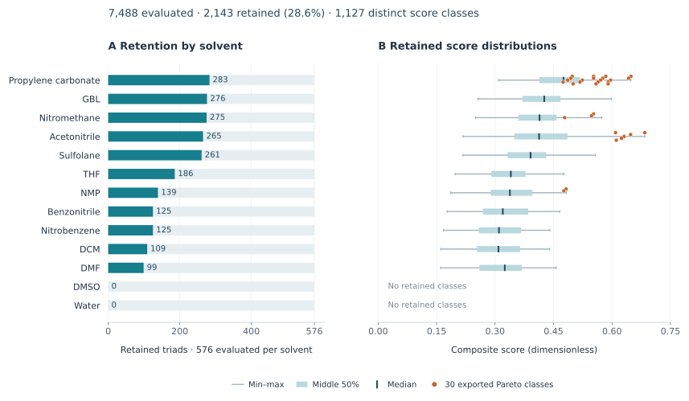

# electropoly-jointopt-hts

CombHTS screens monomer–solvent–electrolyte combinations for
electropolymerization. It addresses a coupled selection problem: a promising
monomer also needs a compatible solvent and supporting electrolyte under the
conditions required for oxidation and polymer growth.

## Approach

CombHTS separates molecular calculations from combinatorial ranking. It
calibrates per-species property estimates, applies compatibility constraints,
and ranks the surviving combinations.

Molecular descriptors are computed for individual species and solvent
environments, then reused across candidate combinations. This avoids repeating
the same calculation for every triad and makes the combinatorial screen a
table-assembly and scoring problem.

Candidate eligibility depends on three conditions:

- Monomer oxidation falls within the solvent's electrochemical window.
- The supporting electrolyte is stable at the required potential.
- A solvation-based criterion supports monomer–medium compatibility.

Regression calibrates lower-cost property estimates against reference values.
Property-specific validation informs how those estimates are used in screening,
while configurable scores rank the eligible combinations.

## Recorded results

The June 2026 screen evaluated 7,488 combinations from 36 monomers, 13 solvents,
and 16 salts. Applying the salt-role and compatibility filters retained 2,143
combinations, from which 30 distinct ranked candidates were exported for review.

The June 22 computational-screen snapshot: bars show retained triads; whiskers,
boxes, and ticks show the range, middle 50%, and median of all 1,127 distinct
score classes. Orange points mark the 30 exported Pareto candidates.
[Figure data and provenance](docs/figures/screening_snapshot_20260622.json).

The [June 23 validation](docs/runs/2026-06-23_directive-section7-validation-417671.md)
recorded a monomer-oxidation leave-one-out mean absolute error of 0.186 V.
The [calibration manifest](configs/CALIBRATION_ACTIVE.md) tracks subsequent
engine and calibration revisions. Full-space studies use separate datasets and
run records.

## Documentation

- [Methods and implementation](docs/code_structure.md)
- [Related project stages](docs/project-map.md)
- [Screening and candidate analysis](docs/runs/2026-06-22_analyze-salt-fixed-417571.md)
- [Property validation](docs/runs/2026-06-23_directive-section7-validation-417671.md)

## Research context

[Jackson Lab, UIUC](https://thejacksonlab.github.io/).

Background: J. Chem. Inf. Model. 2018, 58, 2450–2459;
Chem. Rev. 2026, 126, 28–79.
